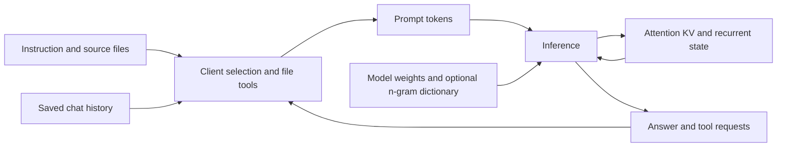

# RAM, VRAM, quantization and context

**9 November restart update:** Flash-Next Q2 / Strata 0.1.50's 64K
GPU-KV growth trial ended in a confirmed 0x116 NVIDIA timeout-recovery crash
at 10:10:57 IST. Its 8K/17K fact answers and allocation growth are observations;
the interrupted 33K case and unrun shrink/private audit have no score. The exact
configuration is quarantined, no engine is running, and production remains off.
See the [incident and configuration](../reports/2026-11-09-flash-q2-gpu-restart.md).
This records workload association, not a proven parameter-level cause.

9November FlashQ2 capacity check: no orphan inference engine was present
before the static launch; applications stayed open. The native engine peaks
at its4GiB resident cap and about5.24GiB dedicated GPU allocation. These are
not exclusive additions to total RAM: Windows shared GPU memory, mapped
file pages, commit and process working sets overlap in different ways.
Device-free VRAM fell to1294MiB while the engine printed3947MiB; the external
device measurement governs the guard. After normal cleanup the snapshot
shows15.74GiB available RAM, but changing desktop activity prevents assigning
the full before/after delta exclusively to the model.

The interrupted follow-up native KV-growth test used 64K maximum, 16K
initial allocation and 8K steps. Its native log records 16,384 cells / about
0.23 GiB initially, then 24,576 / 0.33 GiB for the 17K input and 40,960 /
0.52 GiB for the 33K input. Those increases give up 74 and then 146 expert
cache slots, leaving 292 of the original 512 slots. The completed 8K and
17K visible answers contain all five requested facts; the 33K answer and shrink
event are unavailable after the system crash. No normal-cleanup assessment exists.

This is **GPU** virtual-memory growth, not the earlier host-KV streaming
profile and not proof that llama.cpp dynamically grows its reserved CPU KV.
All four inputs independently include their source facts; they do not test
remembering an omitted earlier chat. The native source also permits fresh
VRAM allocations after the expert cache reaches its floor. Therefore a
configured context maximum is not a guarantee of constant total GPU use.

## 9 November: cache capacity, live context and correctness

The completed Flint Q3XL72K private audit reached42,290input tokens and
4,368generated tokens in its last turn. All8continuations reused the full
available previous prefix. Yet the final answer scored25/36 and failed two
code behavior groups. Actual retained computation is not proof of correct
instruction application. [Reviewed receipt](../reports/2026-11-09-flint-q3xl-private72k.json).

Its primary GPU KV allocation was1071MiB global attention plus27.890625MiB
sliding-window KV, allocated for the configured capacity. The1GiB process
resident cap and18.495GB weight file measure different things. The separate
expert-cache budget256MiB produced243.08MiB actual cache; the new1536MiB
performance control allocates1531.97MiB. Neither is chat KV.

`--cache-ram 0` disables the additional server prompt-cache store; it does
not disable an active slot's KV prefix reuse. The fixed-prefix control reuses
1894tokens with that flag, while a middle edit forces a full re-prefill when
sliding-window checkpoints cannot rewind to the changed region. Keep active
context, checkpoint rollback and the additional prompt cache separate.
[Performance evidence](../reports/2026-11-09-flint-prefill-controls.json).

Increasing RAM residency or GPU cache is being measured separately from
context capacity and answer quality. No universal bytes-per-token formula,
"use all VRAM" rule, or unlimited-memory promise follows from these figures.

The new short2K/windowed control confirms29.75MiB global plus27.89MiB
sliding-window KV. Its otherwise matched b64/u64/cache1536/resident3 cold
request takes191.922s, versus191.937s in the72K-capacity control. In this
small single-pair observation, reserving a larger context costs more KV
storage without a measurable cold-request timing difference. It does not
mean actually processing72Kinput is cheap, or establish long-context recall.
The matched2K full-storage control completes with29.75+74.38MiB KV.
After a middle edit it reuses962tokens and processes933new ones, versus
zero reused/1895new in the windowed control; wall time falls145.562→95.562s.
Both runs stop normally. All three short output texts differ, and cold/repeat
generation slows, so this is a measured reuse/memory tradeoff rather than
an output-equivalent optimization or recall score. Full storage retains
computed KV for rollback; it does not extend Flint's trained attention window.

Scaling that same measured geometry to72K gives a useful **capacity estimate**:
full storage for the35sliding-window layers would be2677.5MiB, versus27.890625MiB
in the current windowed allocation. Together with1071MiB global KV, this is
3748.5MiB total, an increase of2649.609375MiB (about2.59GiB). The active native
audit has roughly2125MiB device memory free, with a400MiB stop reserve, so this
cannot be added to its unchanged GPU profile. This is arithmetic from the logged
head geometry, not a72K full-storage load test. Moving KV to RAM or reducing the
expert cache would change placement/performance and needs a separate qualified
trial. Append-only tool continuations already reuse their full prefix in the
current audit through turn05; the demonstrated short-fixture benefit concerns
rollback after an earlier edit. The later observation below adds a real
partial-reuse case without qualifying a 72K full-storage configuration.

At 07:55 IST the native audit reaches its first partial-reuse continuation.
Turn05 completes 6,908 generated tokens in 1,674.579 seconds, then requests two
source rereads. For the next 46,388-token input, the server restores a checkpoint
and reuses 38,371 tokens, leaving 8,017 to process. The preceding available
sequence was 45,283 tokens. This is partial replay, not a lost whole history.
The logged checkpoint-test value 42,991 is a sliding-window threshold, **not**
the common-prefix length. The precise prompt/token divergence is not yet
established, and the whole 6,912-token difference cannot be labelled avoidable
overhead. No quality score or completed turn06 latency exists at this
checkpoint. [Interim receipt](../reports/2026-11-09-flint-native-rollback-observation.json).
Inspection of saved JSON confirms that all 17 prior messages, the captured
assistant fields and other request parameters were unchanged. Only the new
assistant turn and two tool results were appended. This rules out a collector
rewrite of those earlier messages, but parsed API fields are not a record of
every raw generated token. Exact template/token round-trip identity remains
unproven; do not label this an observed loss of earlier files or reasoning.

A separate passive observation at07:23:20–35IST during native-audit prefill
measures E: reads of142.2–159.9MiB/s, average read latency0.114–0.134ms and
instantaneous disk queue length0–1. The process reports288,288faults/s but
zero ordinary IOReadBytes/s in its separate sample. These are not conflicting
measurements: the counters cover different activity and scopes. A mapped page
can fault without a new disk read; a hard fault can read the mapped backing
file. [Microsoft's working-set description](https://learn.microsoft.com/en-us/windows/win32/memory/working-set)
explains the distinction. Neither process faults times4096 nor the zero ordinary
I/O counter is a valid measurement of model disk bandwidth. Whole-drive reads
also include other processes. This short sample does not establish SSD
saturation. [Observation receipt](../reports/2026-11-09-flint-paging-observation.json).
The subsequent 3 / 6 / 3 GiB residency control completed with that same short
workload. Cached replies took 5.297 / 3.500 / 5.391 seconds; cold requests took
123.016 / 117.203 / 113.735 seconds. The repeat benefit is measurable in this
sequence, but the cold benefit is smaller than baseline drift. The quality
follow-up retains 3 GiB; more residency has no demonstrated accuracy benefit.

## 3 November: GPU placement also spends commit

Saved telemetry shows several CUDA-buffer allocation phases on this WDDM host
raising Windows commit by roughly their device-buffer size. This is measured
behavior, not a universal identity for every allocation. Ordinary file-backed
mapped weights differ from private commit; runtime and staging still cost
commit. The two commit-floor stops examined were triggered by desktop
growth after loading. The auto-managed page file, now 46.4 GiB, grows late and
in small steps. Admission gates must count GPU buffers as commit; see
[VRAM allocations also consume Windows commit](#vram-allocations-also-consume-windows-commit).
Isolated grading in WSL also costs commit, and the audited 20-21 October runs
add file-arena, placement, guard-branch and paging observations; see
[3 November: grading and audit observations](#3-november-grading-and-audit-observations).

## 27 October: what the current experiments establish

The retained production choice is still QwenQ4/128K CPUq8, but it is stopped
during this campaign; older64K recommendations below are dated evidence,
not the current production configuration. No new editor validation is implied.

FlintQ3XL B reserves503.89MiB GPUq8 KV at32K (476global+27.89sliding-window).
A live snapshot reaches10841retained tokens without resizing those buffers.
The runtime's slot field includes generated tokens; its cumulative cached-token
metric is not occupancy. Four bounded context checkpoints are separate.
The120-record workflow later passes8/8 in3380.750seconds, but that does not
establish50K/128K recall. Router/TS exhaust16K output while total tokens remain
under18K; those failures are not a full context window or observed code bugs.
[Occupancy](../reports/2026-10-27-flint-context-occupancy.json),
[completed collection](../reports/2026-10-27-flint-q3xl-file-workflows.json).

The actual older private Flint audit reached41305input tokens and51041total.
A32K public calibration therefore cannot qualify the complete private audit.
The prepared72K profile reserves room for its24K answer allowance and disables
context shifting. It has not loaded yet; subsequent tool growth can still
exhaust even that capacity. [Sizing evidence](../reports/2026-10-27-private-context-sizing.json).

Gemma's new128K history trial did run: it stopped at0.928GiB available commit
during input processing, with no final answer or new hardware event. Physical
RAM and GPU headroom remained above their floors. Increasing only the context
setting did not produce a completed recall test.
[Interruption](../reports/2026-10-26-gemma128-history-resource-stop.json).

Strata's dynamic KV-growth eligibility differs between bounded expert copies
and plain mapping; see the [native-source qualification](tasks/2026-10-26-flash-next/2026-10-26-flash-next-v0.10.0.md#native-kv-growth-qualification).
Neither has a new local growth measurement. Static host KV can retain increasing occupied context even when allocated
bytes stay constant. Neither placement nor allocation automatically delivers
instruction files, prevents client pruning, or persists state after unloading.

## 26 October apps-open observations

Before the new article-driven trials, no llama/Strata engine was loaded and
Ollama listed no models. Windows still had only about12GiB available RAM.
Available memory already includes reclaimable standby pages; the separately
reported standby total is not another pool to add. A stopped engine can leave
reclaimable weight pages cached, without retaining a live model process.
Installed64GiB RAM plus10GiB VRAM cannot be treated as74GiB available for one
allocation while the desktop is using both. See the
[article and memory investigation](../research/reviews/2026-10-26-qwen-articles.md).

Gemma26's CPU28/64K GPUq8 profile again measures680.00MiB global plus132.81MiB
sliding-window KV. Its mapped model span is12868.41MiB, while process physical
residency is separately limited to4or6GiB. The unchanged first two coding
answers finish28-29% sooner at6GiB, with identical delivered text; desktop
load and file-cache state remain confounds. A larger resident allowance can
help paging overhead, but does not improve the precision of the model or
remove bugs in an identical answer. A short sample has many process faults
and zero hard page reads; faults alone do not prove SSD bottlenecks.
[Matched output/timing pairs](../reports/2026-10-26-gemma-residency-pair.json).

These new short coding requests do not establish additional long-context
recall. The separately frozen128K larger-history trial later resource-stops,
as recorded above. Both phases and changed-file recovery must complete before
its context setting can be credited as useful retention.

## Measured capacity versus occupied tokens

The client and its tools decide which file contents reach the model. The
model's weights, including Flash-Next's n-gram dictionary, are a separate
resource from the state computed for that prompt:



CPU/GPU placement controls where weights and state are stored or computed.
It does not select the right files for the client. A changed file must reach
the next prompt through a new read or updated attachment. After unloading,
the client must send the necessary history again; a large context setting
alone does not supply it. Persistent session features require separate
verification of what was saved, restored and refreshed.

The [16 October growth experiment](../reports/2026-10-16-context-growth.json)
distinguishes **configured capacity**, **occupied token cells** and **process
memory**. With 64K CPU q8 KV, the runtime reserves 680 MiB at load. Increasing input
from 1,995 to 59,955 tokens left this reservation unchanged and post-answer process
RAM near 17.88–17.89 GiB. All five requested source facts passed; the subsequent
changed-file/history answer also passed and reused 59,951 cached input tokens.

Increasing the server setting to 128K reserves 1360 MiB CPU KV at load. Recurrent
state remains 62.81 MiB, while GPU compute buffers increase 273→507 MiB. Thus
occupied context grows without a corresponding linear rise in the process
graph, but a larger configured capacity can increase multiple allocations.
At 119,943 input tokens, all-CPU KV completed in 733.063 seconds and default
mixed CPU/GPU placement in 610.016 seconds. Both recovered all five facts, but
both added a Markdown fence against the plain-JSON instruction. Updated-file
history follow-ups passed; omitting history returned UNKNOWN. These synthetic
inline probes do not certify autonomous retrieval of repository instructions.

The 128K CPU run used 18.580 GiB resident RAM and 5.104 GiB dedicated VRAM;
mixed placement used 17.477 and 6.199 GiB respectively. Private committed bytes
stayed near 24.15 GiB in both. These counters overlap different resources and
must not be added as three independent physical allocations. The GPU run left
775 MiB device VRAM free and about 1.76 GiB available commit at the reported
post-answer snapshot. Keep 64K as the working default until a larger profile
earns its place through actual workload tests.

The launcher also supports an optional `stop_min_commit_available_gib` guard.
Physical availability and Windows commit headroom are distinct constraints.
Experimental mmap profiles may set `working_set_limit_gib` to bound only the
owned server's resident pages. This is neither a commit limit nor extra memory;
it may cause page faults and slower inference. Actual guard/limit receipts are
saved beside each run. The existing working profile is unchanged.

With `working_set_reserve_gib`, the resolved cap is the smaller of the explicit
limit and currently available physical RAM minus that reserve. The new larger-model
initial trials reserve 5 GiB at preflight; the revised 80B profile reserves
7 GiB and additionally caps resident RAM at 14 GiB. These limits allow use of
more RAM only when it is actually available;
they do not assume that every process may consume the machine's full 64 GB.
The guard continues monitoring afterward because other applications can grow.

| Concept | Changes | Does not guarantee |
|---|---|---|
| Weight quantization | Stored parameter precision and footprint | Correct syntax or reasoning at Q6/Q8; automatic failure at 3-bit |
| KV/state precision | Representation of cached attention/recurrent state | Perfect recall of every file |
| Layer/expert placement | Which device stores and computes model components | A universal safe number of GPU layers |
| Context length | Maximum token workspace exposed to a request/slot | Permanent history or automatic instruction-file loading |
| Prompt/slot cache | Reuse of eligible computation/state | A durable searchable repository memory |
| GPU expert cache | Copies of CPU-resident experts cached in VRAM | Removal of the original CPU weights |

The Windows monitor also records **commit limit and available commit** through
`GlobalMemoryStatusEx`. These values can reflect a tighter limit on the calling
process; they are not a separate measurement of system-wide commit when such a
limit applies. See [Microsoft's field definitions](https://learn.microsoft.com/en-us/windows/win32/api/sysinfoapi/ns-sysinfoapi-memorystatusex).
Commit
is a separate allocation constraint from physical RAM and GPU VRAM; a machine
can have free physical memory while much of its commit allowance is reserved.
The later unexpected-shutdown heartbeat reported 92.1% commit, but did not
establish that commit exhaustion caused the failure. The new telemetry improves
future diagnosis; it is not evidence that the restart was fixed. WDDM shared
GPU memory overlaps system RAM and must not be added as independent capacity.
3 November: dedicated VRAM allocations draw on the same commit; see
[VRAM allocations also consume Windows commit](#vram-allocations-also-consume-windows-commit).

The actual Qwen3.6 32K diagnostic allocated **340 MiB attention KV** plus
**62.81 MiB recurrent state**. KV split was 68 MiB CPU / 272 MiB GPU. A simple
doubling gives 680 MiB attention KV at 64K; state does not necessarily scale
the same way. A generic claim that every model needs 16 GB KV at 32K is wrong.
Architecture, layers, heads, dimensions, precision, slots and backend all matter.

For this Qwen architecture at64K, the pinned block layouts imply attention
payloads of1280MiB f16,680MiB q8_0 and360MiB q4_0. Quantized blocks also store a
scale, so q4 is not exactly half the q8 bytes: its calculated saving is320MiB.
Only q8 is measured in the current context sweep; the q4 figure is not a load,
compatibility or recall-quality result. Additional state/workspaces are separate.
[Source and calculation](../research/reviews/2026-10-14-gemini.md#16-october-measured-context-allocation-and-retention).

The selected configuration2.0 now confirms the64K allocation directly:
**680MiB attention KV =136MiB CPU +544MiB GPU**, with **62.81MiB recurrent
state =18.84MiB CPU +43.97MiB GPU**. Model buffers are4383.13MiB GPU and
16715.52MiB host; compute buffers273MiB GPU and22.36MiB host. Readiness uses
about17.0GiB processRAM/5.38GiB dedicatedVRAM; the finalist suite peaks at
18.09GiB processRAM. These are measured components, not numbers to add to an
already measured process total. Partial CPU/GPU state placement follows the
30GPU-layer profile; it does not use an all-RAM-KV flag.

In the pinned runtime, `--no-kv-offload` requests host-side KV. GPU offload flags
do not mean "put KV in RAM." Moving this relatively small cache to RAM could
recover some VRAM but uses more host memory and may slow attention. It cannot
solve dense CPU matrix multiplication or a host-RAM shortage. The new dense
Gemma 31B trial **did measure RAM KV**: 1211 MiB q8 cache at 16K, about 5.98 GiB
dedicated process VRAM, peak sampled process RAM 14.57 GiB, and 0.95 generation
tok/s before its five-minute calibration deadline. The GPU-KV attempt stopped
at its VRAM guard, so this is not a completed A/B measurement of the cache move's
speed penalty. [Trial evidence](../reports/2026-10-15-campaign.md).

The later **Qwen Q4 RAM-KV** probe also completed: 680 MiB attention KV and
62.81 MiB recurrent state on CPU, 2.43 GiB dedicated process VRAM, 21.04 GiB peak
sampled process RAM. Generation was about 13 tok/s; the coding/history prompts
took 408/242 seconds and passed their code/recall checks. The 1536 MiB expert-cache
GPU-KV profile generated about 38-39 tok/s but used 4.76 GiB dedicated VRAM and
20.34 GiB peak process RAM. The two profiles also differ in expert caching, so
this is a practical option comparison, not an isolated universal KV penalty.
For this architecture, keeping KV/state on GPU is currently preferable when it
fits. The expert cache still keeps the original host weights and does not make
context permanent.

`--gpu-layers all --cpu-moe` completed the measured Qwen placement experiment:
offload eligible non-expert computation while keeping routed experts on CPU.
It may increase host memory
because experts previously on GPU move back to RAM. Shared experts, embeddings,
output tensors and compute buffers must be checked from actual loader logs.
Do not label all layers equally sized or reuse a 28-layer limit across families.
See [pinned flag definitions](https://github.com/ggml-org/llama.cpp/blob/b2f036c0f138414dedc987446f1d9d802f920275/common/arg.cpp).

The measured Gemma 26B balanced profile keeps experts from 24 blocks in RAM and
the final six on GPU. At 32K its active q8 KV is only **473 MiB on the GPU**,
while readiness dedicated process VRAM is **4.97 GiB**. Model host buffers are
10379 MiB; total resident RAM also includes runtime overhead and context
checkpoints. These figures are specific to this artifact and placement.
At 64K with the same placement, the measured cache is **813 MiB**: 680 MiB
global plus 133 MiB sliding-window, all on GPU. Readiness dedicated VRAM is
**5.31 GiB**. Doubling context did not double every cache component; recall
quality is being tested separately from successful allocation.

The pinned Gemma header has 25 sliding-window and five global-attention blocks.
Use those actual arrays and measured padded allocation, rather than the external
research's incorrect 26/four split, when estimating a larger context.

GLM-4.7-Flash's measured 32K MLA cache is **898.88 MiB**, reported as
K q8_0 = 898.88 MiB and V q8_0 = 0.00 MiB. MLA uses shared latent storage;
the zero separate V allocation is not evidence that the conversation was
discarded. Its first Q4 balanced load uses about 4.90 GiB dedicated process
VRAM and 13.40 GiB sampled process RAM. Do not apply the Gemma or Qwen cache
formula to this architecture, or add a second assumed value cache to the log.

Kimi Linear demonstrates a compatibility limit as well as different sizing.
The pinned runtime rejects q8 V because its value-head dimension72 is not
divisible by block32, then rejects differing K/V types. Matching f16 loads at
32K with **252 MiB KV**, **42.81 MiB recurrent state** and **949.13 MiB GPU
compute buffers**. Readiness dedicated VRAM is7.09GiB and peak process RAM
23.24GiB. Its510MiB minimum freeVRAM is too narrow to reuse that placement at
64K without a separate capacity adjustment/test. Quantized KV is not a
universally supported requirement, and active KV alone is not total memory.

Qwen3-Coder 30B at the same 32K context uses **1632 MiB q8 KV**: 816 MiB each
for K and V. Its measured balanced placement uses 5.80 GiB dedicated process
VRAM and a peak sampled 13.28 GiB process working set. A separate tokenizer
measurement finds **27,488 tokens** in the 15 actual instruction-source files
alone, excluding wrappers, tool declarations, chat history and the answer.
This supports the planned 64K private audit; it does not imply every task should
load every instruction file or that all those sources were delivered in a run.

The16October dense Gemma31 follow-up now measures **3251.25MiB CPU q8 KV at
64K**:2720MiB global plus531.25MiB sliding-window cache. Readiness dedicated
VRAM is5.648GiB; an early native-thinking snapshot has17.202GiB process RAM.
The GPU workspace alone is797.63MiB, illustrating why the old16K memory
estimate cannot be carried over unchanged. These are loading/early-run figures;
the completed public suite peaks at17.202GiB residentRAM. The private audit
peaks at19.218GiB before a documented reduction to17.202GiB and finishes normally.
[Measured dense setup](../reports/2026-10-16-gemma31.json).

`--cache-ram 0` does not disable every reuse buffer. This runtime separately
defaults to **32 context checkpoints per slot** (`--ctx-checkpoints`). The earlier
Gemma26 logs show individual full sliding-window checkpoints of about106MiB, in host
memory. Do not call that additional allocation permanent chat memory, or assume
the active attention KV figure describes the whole process. Fewer checkpoints
can change cache reuse and prefill work. Kimi uses four in the completed32K
suite, but there is no isolated checkpoint-count A/B result.

The16October Gemma31 run retains one checkpoint. Its logged serialized size
grows from3.322MiB to425.013MiB as the occupied prompt fills the sliding window,
while the active3251.25MiB KV allocation stays reserved. Old checkpoints are
replaced at the configured one-checkpoint limit. Thus some context-related
memory can grow with occupancy even though the primary KV buffers are fixed;
neither number alone is total process RAM.

The 17 October Qwen Q6 private run provides a different measured pattern:
serialized recurrent checkpoints are 62.813 MiB each when their recorded
token counts are 423, 2,193 and 14,911. The configured maximum is four, and the log
records replacement of older checkpoints. Active attention KV remains a
separate 680 MiB GPU allocation. A checkpoint count can change context-related
storage without growing the primary attention buffer; do not attribute the
entire process-memory change to those checkpoints or add them again to an
already measured process total.

Cache allocation also does not guarantee reuse. In the dense Gemma history
follow-up, the server explicitly reset cached tokens to zero and reprocessed
the prompt because its retained sliding-window checkpoint could not restore
the changed prefix. Actual template/tokenizer probes show why the default
`preserve_thinking=false` matters here: only137 leading tokens remain identical
between requests. Setting true retains10,021 identical leading tokens, adding
341 tokens to the follow-up. Counts exclude the automatically added BOS token.
The true setting has only been rendered/tokenized, not timed or quality-tested;
it is a concrete optimization hypothesis, not a measured speed improvement.
Both settings retain the source facts in the prompt. This is different from
forgetting files or running out of the configured64K capacity.

Context remains useful only when the client actually sends the relevant files,
instructions and history. A CLAUDE import, a Copilot instruction rule and an
ordinary Markdown link have different loading behavior. The benchmark records
exact source delivery and successful reads. Opening a file tab is not proof its
contents reached the model. Editing a file requires a fresh read to avoid stale
answers. The separate `context-v1` scenarios now test changed-file re-reading
and earlier ledger facts; core `router-v1` does not. The larger case contains
43,228 Gemma ledger tokens before chat overhead. Its 64K follow-up recovered all
six final facts and the correct record count at a largest input of 52,231 tokens,
in 631.563 seconds. That is a two-phase long-document result, not an arbitrary
many-turn coding-session guarantee. Long-term project knowledge belongs in
versioned notes plus retrieval.

Native Qwen3.6 thinking on/off differs from llama.cpp's `reasoning_budget_tokens`.
The latter was locally verified as a ceiling of 0/512/2048 tokens; it is not a
trained "xhigh" level. A longer budget can improve a case and still miss files.
Always count prefill, thinking, tool rounds and final text toward the deadline.
In the matched private audit, removing the2048 ceiling produced the exact same
answer and file-read sequence: delivered reasoning was only26-172tokens per
turn in either run. The ceiling was not reached. Raising it cannot by itself
force more reasoning; [the measured comparison](../reports/2026-10-15-campaign.md#qwen-private-reasoning-ceiling-identical-output)
retains the same25/36 score and errors.

Windows mmap has another distinction: virtual mapped size, resident process
working set and system-cached prefetched pages are different counters.
Microsoft documents that
[prefetched pages initially sit outside the process working set](https://learn.microsoft.com/en-us/windows/win32/api/memoryapi/nf-memoryapi-prefetchvirtualmemory).
Large prefetch ranges can still create system memory pressure. The16October
80B load demonstrated why limiting only process residency is insufficient:
its stock mapping attempt exhausted free memory before inference. An isolated
initial-prefetch opt-out subsequently loaded and began inference within the
same resource floors; see the [experiment](../experiments/llama-mmap-prefetch/README.md).
That trades startup pressure for demand paging. It does not turn a45GiB weight
file into a17GiB resident model or make storage as fast as RAM.

## Where the 64 GB goes with apps open

These are separate views of memory, not numbers to add together. At 19:51:50 IST
on 16 October, while the dense Gemma audit was generating:

| Counter | Observed value | Meaning |
|---|---:|---|
| Physical RAM usable by Windows | 63.91 GiB | Installed capacity after hardware reservations |
| Physical RAM available | 5.62 GiB | Headroom for Windows, apps and inference |
| Gemma process working set | 17.20 GiB | Resident process pages, including mapped weights and runtime buffers |
| Gemma private committed bytes | 10.02 GiB | A commitment counter; overlaps resident memory and is not extra RAM |
| Edge process working sets, summed | 7.97 GiB | Approximate browser footprint; shared pages can be counted more than once |
| VS Code process working sets, summed | 7.26 GiB | Approximate editor footprint, with the same shared-page caveat |
| WebView process working sets, summed | 1.59 GiB | Other embedded browser processes |
| Existing pagefile usage | 3.92 GiB | Storage backing, not additional physical RAM |

Windows therefore had about 58.29 GiB of physical memory unavailable for new
allocations in this snapshot. The process figures are not an exact partition of
that total: Windows, other applications, shared mappings and caches also consume
memory. The server's fixed 3.175 GiB active CPU KV allocation is already included
in its process footprint. Filling more tokens does not add that allocation a
second time. The owned server's resident cap was reduced during the private
audit; the intervention and unchanged commit counter are recorded separately in
[the dense result](../reports/2026-10-16-gemma31.json).

3 November addendum: the Gemma private committed bytes row is a commitment
counter, not extra RAM. About 5.41 GiB of its 10.02 GiB is charged for CUDA0
buffers (4745.60 MiB model + 797.63 MiB compute) and 3.18 GiB for CPU KV (log
of `gemma31-publisher64-private`, `server-20261016-181848`; `PrivateUsage`
10.020 GiB at 19:51:50). See
[VRAM allocations also consume Windows commit](#vram-allocations-also-consume-windows-commit).

## Dense placement follow-up

At 32K capacity, Gemma31 reserves 1,360 MiB global plus 531.25 MiB sliding-window
q8 KV. A completed pair keeps that cache on CPU while changing weight placement:
all FFNs on CPU versus 14 complete repeating blocks plus output on GPU.
Short-answer generation rises from 1.18 to 1.56 tokens/s, but an 8,115-token
request stays about 7.7 minutes. Cache and weight locations are separate controls.

A third arm moves 408 + 116.88 MiB of KV onto GPU without changing weight
placement. Its 2,060-token request takes 146.109s versus 146.047s with CPU KV,
using 5.906 GiB dedicated process VRAM. The 8K attempt stops during prefill when
free device VRAM falls to 394 MiB; that answer is unscored. The additional consumer
is not identified by the available counters. GPU cache is therefore conditional
on measured benefit and headroom, not automatically preferable for every
architecture and placement. The completed CPU pair also returns UNKNOWN when
history is omitted; neither RAM nor VRAM cache supplies persistent cross-request
knowledge by itself. [Requests, buffers and outcomes](../reports/2026-10-16-dense-placement.json).

## GPU counter limits

Per-process WDDM dedicated/shared counters are supporting measurements, not a
partition of physical VRAM. Cross-process graphics surfaces can appear against
several processes, so summing them double-counts memory. Microsoft also documents
incorrect GPU-process counters on affected Windows10 systems; that article does
not by itself diagnose this Windows11 host. Use loader buffers, device-wide free
VRAM and timestamped process trends together.
[Microsoft counter explanation](https://devblogs.microsoft.com/directx/gpus-in-the-task-manager/),
[documented counter issue](https://learn.microsoft.com/en-us/troubleshoot/windows-client/performance/gpu-process-memory-counters-report-wrong-value).

Before either Q4/Q6 arm, a read-only observer adds per-process GPU samples to
the existing30-second system observations. Its first collection takes2.437s;
it then waits30seconds. A desktop-process counter is already larger than the
contemporaneous device-used total, so this cannot establish exclusive ownership
of every byte. No monitoring floor is changed, and no retrospective cause is
assigned to the dense GPU-cache stop.

## VRAM allocations also consume Windows commit

Recomputed on 3 November 2026 from saved 16–27 October telemetry, plus
read-only system queries that day. No engine or allocation probe was started
for this section. Receipts and scripts are in the ignored
`local-data/2026-11-03-wddm-commit/` folder.

On this Windows 11 host the RTX 3080 runs under the WDDM driver model (NVIDIA
drivers 617.42 and 621.01). The examined CUDA allocation phases raise process
and system commit by roughly their device-buffer size, while working set rises
far less. Budget both VRAM and commit, then measure the actual allocation
phases. Do not assume every future byte placed on the GPU has a fixed charge.
The server's private commit is consequently not a measure of resident host
RAM. Microsoft documents the general
mechanism, but no Microsoft or NVIDIA page found says when, to which process or
at what ratio a CUDA allocation is charged. The 1:1 charge is an **empirical
observation** on this host, consistent with independent third-party reports.

Counters used below:

- System commit used is `commit_limit_gib − commit_available_gib`, from the
  launcher's `GlobalMemoryStatusEx` call.
- The historical device counter is nvidia-smi total minus free, across all
  processes. More precisely this is unavailable device memory: it includes
  driver-reserved memory and is not exactly nvidia-smi's `memory.used` field.
  A9Nov live query gives total10240/reserved187/used6663/free3391MiB (rounded).
  Retain the original calculations; name the counter correctly. Free-memory
  admission and stop floors continue to use the actual `memory.free` value.
- Server commit is `process_private_gib`, the `PrivateUsage` that Microsoft
  defines as the process commit charge.

Samples are about 1.08 s apart, and nvidia-smi and the process counters are
not read at the same instant.

**Allocation step.** Run `server-20261021-113320` (21 October): Qwen3.6 IQ4_XS,
`--n-cpu-moe 34`, 64K q8 GPU KV, mmap.

- The 1.08 s sample containing the `CUDA0 model buffer = 4279.34 MiB`
  allocation shows device VRAM +4.220 GiB (4321 MiB), server commit
  +4.295 GiB (4398 MiB), system commit +4.378 GiB and working set +0.314 GiB.
- In the next 2.15 s the loader reads the mapped tensors to upload them:
  working set +3.695 GiB, server commit +0.000 GiB, system commit +0.023 GiB.
- KV (680 MiB), recurrent state (62.81 MiB) and compute (294 MiB) then add
  0.980 GiB of VRAM and 1.676 GiB of server commit. That step also contains
  warmup and runtime host allocations, so it is not a clean 1:1 test.
- After loading, server commit is 6.426 GiB: 5316.15 MiB of logged CUDA0
  buffers, 21.22 MiB of CUDA_Host buffers, and 1.214 GiB not attributed to any
  logged buffer.

**Replication.** The same first-step test was repeated over 67 saved mmap
`llama-server` loads from 16–27 October. They use four llama.cpp builds
(b11562-noprefetch-v1 ×58, b11838-noprefetch-v1 ×5, b11669 ×2,
prism-b10787 ×2) and 13 GGUF files of Qwen3.6, Qwen3-Coder-Next, Gemma 4,
Flint, LFM2.5 and Ternary Bonsai.

- In the first sample with at least 1 GiB of VRAM growth, server commit
  divided by VRAM growth has a median of 1.038 (IQR 1.029–1.072; 59 of 67
  within 0.95–1.15). That is the allocation plus a median 130 MiB, with a
  median working-set rise of 0.57 GiB.
- The eight outliers are sampling artifacts. Two recorded the commit one
  sample before nvidia-smi showed the VRAM, five caught only part of the VRAM
  growth, and one step began at process start.
- These are repeated loads, 24 of them the same Qwen3.6 Q4_K_M file, not 67
  independent conditions.
- After loading, server commit exceeds the logged CUDA0 and host buffers by a
  median of 1.31 GiB (IQR 1.23–1.38 GiB, 43 loads).

**Relocation control.** 16 October, Qwen3.6 Q4_K_M, 128K, `--load-mode none`.
The CPU-KV and GPU-KV runs hold identical non-mapped buffer totals of
23,067.77 MiB. The GPU run moves 1088 MiB of KV and 43.97 MiB of recurrent
state from CPU buffers to CUDA0. Median server commit is 24.023 GiB versus
24.012 GiB (maximum 24.278 versus 24.270). Moving 1.1 GiB between RAM and VRAM
left commit unchanged. That is why the two 128K runs above show nearly
identical private commit (about 24.15 GiB).

**Placement control.** 21 October, IQ4_XS `--n-cpu-moe` 37 → 34. Putting three
more expert blocks on the GPU grows the CUDA0 buffers from 4248.15 to
5316.15 MiB (+1.04 GiB) and shrinks `CPU_Mapped` from 15,162.08 to
13,907.57 MiB. Post-load server commit rises from 5.38–5.47 GiB to 6.43 GiB.
The device growth is charged; the mapped bytes moved off the CPU had never been
charged.

**Strata.** 21 October: Q4_K_M, 32K, an 18.23 GiB file-backed expert arena,
CUDA 13.3 libraries.

- Three allocation steps show VRAM +1.165, +1.340 and +1.948 GiB against system
  commit +1.552, +1.417 and +1.843 GiB (ratios 1.33, 1.06 and 0.95).
- From process start to the end of allocation, VRAM grows 5.154 GiB and commit
  7.126 GiB. About 72% of the startup commit (engine plus Python wrapper)
  therefore tracks VRAM.
- One step adds 1.057 GiB of commit for 0.117 GiB of VRAM, which is a host
  allocation.

This telemetry has no per-process commit counter, and engine RSS also rose
about 1 GiB in each of the first two steps. Strata therefore supports the
finding, in a different engine and CUDA version, but does not isolate it.

**File-backed control.** A 2 GiB read-write view of a data file, written in
full, moved system commit from 82.05 to 81.97 GiB (`commit_probe.py`,
21 October 12:05:52 IST; its output survives only in the session transcript).
Filling Strata's file-backed arena raised engine RSS by 13.66 GiB while system
commit fell 1.23 GiB. That run stopped on the 0.5 GiB free-RAM floor, not on
commit.

### Documentation and outside reports

- **Microsoft, WDDM backing stores.** "Every graphics allocation in the WDDM
  model has a backing store". A backing store is "a committed memory buffer
  that holds the contents of a graphics allocation when it's not resident in
  video memory"
  ([Sharing the Backing Store with KMD](https://learn.microsoft.com/en-us/windows-hardware/drivers/display/sharing-backing-store-with-kmd)).
  Video memory segments are shared across applications and over-committed, and
  the video memory manager manages GPU page tables
  ([GPU virtual memory in WDDM 2.0](https://learn.microsoft.com/en-us/windows-hardware/drivers/display/gpu-virtual-memory-in-wddm-2-0)).
  This explains why a GPU allocation needs commit. It does not say when the
  charge is taken, to which process, or that a CUDA buffer becomes a WDDM
  allocation of equal size.
- **Microsoft, commit accounting.** The commit limit is physical memory plus
  all page files. At the limit, "the system and processes might not get
  committed memory"
  ([Introduction to the page file](https://learn.microsoft.com/en-us/troubleshoot/windows-client/performance/introduction-to-the-page-file)).
  Private and pagefile-backed memory count. A file mapping view does not count
  "unless the application asks for copy-on-write semantics"
  ([Russinovich, 2008](https://learn.microsoft.com/en-us/archive/blogs/markrussinovich/pushing-the-limits-of-windows-virtual-memory)),
  and `SEC_COMMIT` has no effect for data-file mappings
  ([CreateFileMapping](https://learn.microsoft.com/en-us/windows/win32/api/winbase/nf-winbase-createfilemappinga)).
  `PrivateUsage` is "The Commit Charge value in bytes for this process"
  ([PROCESS_MEMORY_COUNTERS_EX](https://learn.microsoft.com/en-us/windows/win32/api/psapi/ns-psapi-process_memory_counters_ex)).
- **NVIDIA.** Pinned host memory "reduces the amount of memory available to the
  system for paging"
  ([CUDA Runtime API 13.4](https://docs.nvidia.com/cuda/cuda-runtime-api/group__CUDART__MEMORY.html)).
  No NVIDIA page found says that `cudaMalloc` under WDDM is charged to commit
  or needs page-file backing.
- **Third-party reports** (not vendor statements) describe the same effect:
  - In 2020 an NVIDIA forum user saw a 600 MB `cudaMalloc` raise Task Manager
    commit by "600MB or more" with no increase in physical memory
    ([thread](https://forums.developer.nvidia.com/t/cudamalloc-increase-the-commit-memory-in-win10/118351)).
  - An October 2026 report on RTX Spark (ARM64) measured a 64 MiB
    `cuMemAlloc` adding 64.125 MiB of `PrivateUsage` with a 16 KiB working
    set, and a ~1 GiB D3D12 heap using ~1 GiB of commit. NVIDIA had not
    replied
    ([thread](https://forums.developer.nvidia.com/t/rtx-spark-on-windows-cuda-allocations-consume-system-commit-even-with-96-gib-dedicated-gpu-memory/386453)).
  - A merged Unsloth change measured 5139 MiB of GPU buffers adding
    5467–6180 MiB of system commit under ROCm and Vulkan on an AMD APU
    ([PR 16046](https://github.com/unslothai/unsloth/pull/16046)).
  - A TyloQuant change budgets CUDA device memory against commit for the same
    reason ([PR 169](https://github.com/Tylogi/MFQ/pull/169)).

  The D3D12 and AMD results point to WDDM rather than to CUDA alone.

### What it means for placement

| Bytes | Commit | Resident RAM | Evidence |
|---|---|---|---|
| CUDA0 buffers: weights, KV, recurrent state, compute | About their size | ~0 | 67-load first steps; relocation control |
| mmap'd CPU weights (`CPU_Mapped`, read-only view) | 0 | Touched pages only; discardable and re-read from the GGUF | IQ4 upload: working set +3.70 GiB, commit +0.02 GiB |
| Read-write file-backed arena (Strata `FILE_ARENA`) | 0 | Dirty pages until written back to the file | RSS +13.66 GiB, commit −1.23 GiB; RAM-floor stop |
| Pinned host buffers (`CUDA_Host`; Strata's default arena) | Their size | Their size, page-locked | 16,715.52 MiB `CUDA_Host` weights (16 Oct) |
| Pageable private memory (CPU KV, `malloc` arena) | Their size | Touched pages; pageable | Relocation control |
| llama.cpp CUDA runtime outside logged buffers | 1.2–1.5 GiB | Not separated | 43 loads; 16 Oct pair about 1.5 GiB |

GPU expert placement is paid twice, in VRAM and in commit.

- Moving expert blocks from `CPU_Mapped` to the GPU returns no commit. The RAM
  it frees is reclaimable file cache.
- A GPU expert cache is also a CUDA allocation, so it should be charged the
  same way. This was not measured in isolation.
- KV costs the same commit in VRAM as in RAM, so where to put it is a decision
  about VRAM, RAM and speed.
- Long-lived host copies are the expensive case. The old non-mapped Q4
  launcher held about 24 GiB: 16.32 GiB of pinned host weights, 4.78–5.88 GiB
  of CUDA0 buffers, host KV and runtime. Mapped Q4 and IQ4 profiles hold
  5.4–6.5 GiB, mostly charged for VRAM.
- Strata's default pinned arena would add the whole 18.23 GiB expert set to
  commit. Its file arena avoids that charge, and the untested read-only expert
  pack should avoid it by design.
- If VRAM were oversubscribed, the video memory manager could evict an
  allocation into its backing store. That would turn the commit into real RAM
  or page-file use. This is inferred from Microsoft's definition and was not
  observed; the lab's VRAM stop floors keep the server away from it.

### Admission gates and the 1.0 GiB floor

- **Predict server commit from the load plan.** After loading, server commit ≈
  ΣCUDA0 buffers + Σnon-mapped `CUDA_Host`/`CPU` buffers + about 1.3 GiB;
  `CPU_Mapped` adds nothing.
  - IQ4_XS moe34 needs 5.19 + 0.02 + 1.21 = 6.43 GiB, yet its profile's
    admission threshold was 4 GiB of available commit. The actual preflight
    had 11.95 GiB.
  - The Strata file-arena guard also used 4 GiB. Its load took 7.13 GiB of
    the 8.61 GiB available, and available commit bottomed at 1.476 GiB.
  - A sound gate is at least the predicted server commit, plus the 1.0 GiB
    floor, plus a desktop margin.
- **Bursts outrun the monitor.** The model-buffer allocation took 4.378 GiB of
  system commit within one 1.08 s sample. The running guard cannot take back a
  grant already made; only admission can prevent it.
- **Both commit-floor stops examined here came from other processes after
  loading.**
  - 21 October: system commit grew 5.119 GiB in the 17.2 s after loading;
    server commit grew 0.149 GiB.
  - 26 October, Gemma 128K: system commit grew 5.270 GiB versus 0.241 GiB for
    the server over 61 minutes. Server commit there was 4.731 GiB against
    3516.24 MiB of CUDA0 buffers.
  - The floor protects the owner's applications. The engine's GPU-charged
    commit stays until its buffers are freed or the process exits.
  - Desktop growth of about 5 GiB was seen both over 17 seconds and over an
    hour, so the margin should cover it.
- **The system-managed page file is a lagging safety valve, not capacity.**
  - Microsoft documents growth once commit reaches 90% of the limit. Yet the
    limit stayed at 89.910 GiB while commit reached 99.0% (21 October, 24 s).
    It also stayed at 106.326 GiB for 61 minutes while 793 of 794 samples were
    at or above 90% (26 October).
  - Growth was observed in steps of about 1–2 GiB when commit was close to the
    limit, and was later truncated, as Russinovich describes. On 24 October the
    limit gained 1.006 GiB at 01:02:39 with 1.282 GiB available, and was back
    to 91.910 GiB by 01:06:07.
  - Gates must keep using fresh `commit_available_gib`, never a peak or a
    historical limit.
- **Page-file history.**
  - 26.0 GiB in every 21 October run (commit limit minus RAM).
  - 28.0 GiB in 23–25 October records.
  - A persistent 42.4 GiB from 26 October 08:05. The growth happened after
    25 October 00:46; no lab telemetry covers that window, and the cause is
    not identified.
  - 46,499 MiB (45.4 GiB, limit 109.32 GiB) at about 18:55 IST on 3 November,
    then 47,530 MiB (46.4 GiB, limit 110.33 GiB) by 19:16.
  - Peak commit since the 23 October boot is 113.18 GiB, so the limit has
    briefly been at least that high.
  - Most of the page file is reservation: 9.65 GiB was in use at 19:16, and
    at most 12.0 GiB had been used since boot.
  - Microsoft caps growth at 3× RAM and at one eighth of the volume, about
    119 GiB on this 952 GiB C:. Growth also needs free disk space; C: had
    59.5 GiB free at 19:17.
- **3 November, 19:16 IST.** No `llama-server` or Strata process was running
  and Ollama had no model loaded. Commit was 105.10 of 110.33 GiB (5.23 GiB
  available), RAM available was 7.75 GiB and VRAM free was 6198 MiB. A mapped
  Qwen profile needs about 5.5–6.5 GiB of server commit, which would use all
  of the available commit before the floor or any margin is counted.

### Not established

A controlled `cudaMalloc`/`cudaFree` probe has not been run. Low commit
headroom and the owner's open applications ruled it out on 3 November. The
probe would record `PrivateUsage`, inspect new regions with `VirtualQuery`, and
check whether the charge is released on free or only at process exit. One
third-party report saw part of it persist after `cuMemFree`.

Also untested on this host:

- commit accounting for desktop D3D and browser GPU allocations
- the TCC compute-only driver model
- what triggered the persistent page-file growth of 25–26 October

## 3 November: grading and audit observations

### WSL isolated grading and the run C native stop

Grading in WSL is not free on this host. With apps open on 3 November, one cold
WSL2 boot for `scripts/run_isolated.py` cost about 1.8 GiB of available RAM and
2.2 GiB of commit: commit fell from 3.396 to 1.207 GiB, and the VM held
1.2-1.7 GiB until its idle shutdown about a minute later. Batch every reviewed
grading directory into one boot, gate on available commit as well as RAM, and
never overlap grading with an inference run.

Run C's native 32K stop (27 October 07:20:46 IST) came from outside the engine.
In the final 26 seconds available RAM fell from 5.015 to 2.265 GiB and commit
from 5.249 to 2.671 GiB, while the model process's 1 GiB working set and
3.667 GiB private commit stayed flat. The guard is doing its job; the trigger
was desktop growth these counters cannot attribute to a process.
[Receipt](../reports/2026-11-03-flint-runC-grades.json).

### 20-21 October memory observations (audited 3 November)

- **File-backed sections on Windows.** A file-backed expert arena on Windows
  (Strata `STRATA_Q36_FILE_ARENA`, 18.23 GiB) left available commit at
  1.48-2.72 GiB while it filled. However, engine memory rose to 15.98 GiB and
  free RAM fell from 12.93 to 0.364 GiB in 35.6 s, so the RAM floor stopped it
  before readiness. Avoiding commit charge does not avoid physical residency
  when a copy loop touches every page. A read-only mapped pack is built but
  unmeasured.
- **Moving expert blocks to the GPU.** For Qwen IQ4_XS, going from 37 to 34 CPU
  expert blocks moved 1,254.51 MiB of CPU-mapped weights and added
  1,142.00 MiB of CUDA weights. On that desktop the load still exhausted commit
  (0.903 GiB) within 24 s.
- **Guard stops can be telemetry failures.** A resource guard that treats a
  missing reading as a floor breach can stop a run on a telemetry failure. The
  21 October IQ3_S stop came from an nvidia-smi read error while 1,152 MiB or
  more VRAM remained free. Record which branch of the guard fired.
- **Paging cuts decode speed.** Paging alone reduced LFM2.5 decode from about
  23 to 4-5 tok/s: 72,783 page faults, median free RAM 2.67 GiB. Treat a
  deadline under paging as an unscored throughput failure, not as evidence
  about answer length.
- **Prism fork host memory.** The Prism fork held 9.6-9.8 GiB of private host
  memory throughout, even with every Bonsai PTQ1_0 layer on the GPU; CPU K/V
  accounts for only 2.1 GiB of that.

## Completed apps-open precision comparison

The mapped Q4 control peaks at16.384GiB resident RAM and6.213GiB private commit
in the public suite, leaving at least3.696GiB system RAM and1909MiB device VRAM
free. Its private audit scores31/36 in11m40s. Q6 peaks at17.778GiB resident and
7.077GiB private commit, with2.883GiB RAM and981MiB VRAM minimum headroom; it
scores28/36 in35m. These are different resident caps on a shared desktop, not
an exclusive total-memory partition or proof all weights fit physically.

Keep64K q8 GPU KV and native thinking. CPU KV is an option when VRAM is the
binding limit; it does not improve intelligence or guarantee persistent files.
The old non-mapped launcher can require about24GiB private commit. At the
closeout snapshot only18.4GiB commit was available before loading, so it was
not restarted. The mapped profile's guarded alternative is:

```powershell
python lab.py --data-dir E:\llm\lab-data run --profile qwen36-q4-noprefetch64-control --runtime-dir E:\llm\runtimes\b11562-noprefetch-v1 --model-path E:\llm\models\Qwen3.6-35B-A3B-UD-Q4_K_M.gguf --port 8081 --experimental --apply
```

The isolated runtime must be built/verified as documented in
[the runtime experiment](../experiments/llama-mmap-prefetch/README.md); do not
substitute stock binaries silently. The frozen profile intentionally retains
its original pre-test metadata. This command is an explicit lab start, not a
production-editor promotion; current editor aliases/settings remain unchanged.
It retains physical/commit/VRAM/temperature/WHEA guards and a resident cap based
on fresh headroom. See [the completed pair](../reports/2026-10-17-qwen-precision.json).
